# PROYECTO_FINAL_PROGRAMACION-II
El trabajo tiene como finalidad evidenciar las habilidades desarrolladas por los estudiantes para analizar, diseñar y desarrollar una solución informática que resuelva un problema real, aplicando los principios de la Programación Orientada a Objetos (POO).

# Sistema de Optimización Botánica y Paisajismo

Proyecto académico desarrollado en **Java** bajo el paradigma de **Programación Orientada a Objetos (POO)** para la asignatura **ISWZ1103 - Programación II** de la carrera de Ingeniería de Software en la **Universidad de Las Américas (UDLA)**.

---

## Descripción del Proyecto

En zonas con alta actividad florícola y comercial de viveros, como la parroquia de **Nayón (Quito, Ecuador)**, el diseño de jardines y áreas verdes suele realizarse de manera empírica. Esta aplicación resuelve dicha problemática mediante cálculos técnicos y reglas de negocio reales que permiten:

* Evaluar la **compatibilidad biológica y alelopatía** entre especies vegetales.
* Calcular la **densidad máxima de siembra** según el espacio real disponible en metros cuadrados ($m^2$).
* Proyectar los **requerimientos semanales de riego** aplicando una adaptación del modelo térmico **FAO-56**.
* Ejecutar un **diagnóstico fitosanitario** basado en un árbol de decisión de síntomas observables.
* Consolidar **cotizaciones y presupuestos** operativos con márgenes de ganancia dinámicos.

---

## Módulos del Sistema

1. **Módulo 1 — Compatibilidad Biológica:** Registro de fichas botánicas (`RF1.2`) y evaluación de viabilidad entre dos especies considerando requerimientos de luz, tolerancia de pH del suelo y conflictos alelopáticos (`RF1.1`).
2. **Módulo 2 — Modelado Espacial:** Cálculo de densidad máxima de siembra reservando un $15\%$ libre para circulación y drenaje, alertas de saturación (`RF2.1`) y consulta del historial de terrenos (`RF2.2`).
3. **Módulo 3 — Balance Hídrico:** Simulación de evapotranspiración del cultivo ($ET_c$) y generación de cronogramas semanales de riego según la retención del sustrato (`RF3.1`), además de la actualización de variables climáticas locales (`RF3.2`).
4. **Módulo 4 — Diagnóstico Fitosanitario:** Motor de árbol de decisión que identifica la afección más probable a partir de síntomas en hojas y tallo (`RF4.1`), junto con la gestión del catálogo de tratamientos (`RF4.2`).
5. **Módulo 5 — Presupuesto y Cotización:** Consolidación financiera de plantas, sustrato en metros cúbicos ($m^3$), tratamientos, margen de ganancia y envío (`RF5.1`), más la actualización centralizada de precios (`RF5.2`).

---

## Principios de POO Aplicados

* **Encapsulamiento:** Atributos declarados como `private` con acceso controlado mediante *getters* y *setters* validados.
* **Herencia:** `Especie` y `Tratamiento` heredan de la superclase `ProductoVivero`.
* **Polimorfismo:** Sobrescritura del método `obtenerResumen()` (`@Override`) y manejo unificado de productos mediante `ArrayList<ProductoVivero>`.
* **Estructuras de datos:** Uso combinado de arreglos estáticos (`String[]`, `double[]`) para tablas de decisión y colecciones dinámicas (`ArrayList`).
* **Arquitectura por capas:** Separación estricta en paquetes `modelo`, `negocio` e `interfaz`.

---

## Estructura del Proyecto

```text
PROYECTO_FINAL_PROGRAMACION-II
├── .gitignore
├── README.md
└── src
    ├── modelo
    │   ├── ProductoVivero.java
    │   ├── Especie.java
    │   ├── Terreno.java
    │   ├── VariablesClimaticas.java
    │   ├── Tratamiento.java
    │   └── Cotizacion.java
    ├── negocio
    │   ├── GestorCompatibilidad.java
    │   ├── GestorEspacial.java
    │   ├── GestorRiego.java
    │   ├── GestorFitosanitario.java
    │   └── GestorPresupuesto.java
    └── interfaz
        └── MainConsola.java
```

---

## Requisitos y Ejecución

### Requisitos previos
* **Java JDK 17** o superior.
* **IntelliJ IDEA** (Community o Ultimate).
* **Git** instalado (opcional para clonar el repositorio).

### Pasos para ejecutar en IntelliJ IDEA
1. Clonar el repositorio:
   ```bash
   git clone https://github.com/Kinitox/PROYECTO_FINAL_PROGRAMACION-II.git
   ```
2. Abrir **IntelliJ IDEA**, seleccionar **Open** y elegir la carpeta raíz del proyecto (`OptimizacionBotanica`).
3. Verificar que el SDK configurado en `File > Project Structure` corresponda a **JDK 17+**.
4. Navegar al paquete `src/interfaz/` y abrir el archivo `MainConsola.java`.
5. Ejecutar la clase principal haciendo clic en **Run** (o presionando `Shift + F10`).

---

## Equipo de Trabajo (2329 - Equipo 05)

| Integrante | Rol Principal | Módulo Asignado |
| :--- | :--- | :--- |
| **Sebastián Simba** | Líder del proyecto y arquitectura | Módulo 5: Presupuesto y Cotización |
| **Gabriel Torres** | Análisis de requerimientos y diseño UML | Módulo 1: Compatibilidad Biológica |
| **Joseph Oña** | Diseño espacial y validación/pruebas | Módulo 2: Modelado Espacial |
| **Gabriel Anchaluisa** | Desarrollo y análisis ambiental | Módulo 3: Balance Hídrico |
| **Ariel Quezada** | Desarrollo y análisis de datos | Módulo 4: Diagnóstico Fitosanitario |

**Docente:** Ing. Andrés Sánchez  
**Periodo:** 2026 — Quito, Ecuador

---

## Estado del Proyecto

* [x] **Entregable 1:** Análisis del problema, requerimientos funcionales, fórmulas y planificación.
* [x] **Entregable 2:** Diseño UML, estructura de paquetes y aplicación funcional en modo consola.
* [ ] **Entregable Final:** Migración de la capa `interfaz` a interfaz gráfica (Java Swing) y plan de pruebas con evidencias.

## Diagrama de Clases

```mermaid
classDiagram
    namespace modelo {
        class ProductoVivero {
            -String id
            -String nombre
            -double precioUnitario
            +ProductoVivero(id: String, nombre: String, precioUnitario: double)
            +getId() String
            +setId(id: String) void
            +getNombre() String
            +setNombre(nombre: String) void
            +getPrecioUnitario() double
            +setPrecioUnitario(precioUnitario: double) void
            +obtenerResumen() String
        }

        class Especie {
            -String nombreCientifico
            -String requerimientoLuz
            -double phIdeal
            -double diametroCopa
            -double diametroRaiz
            -String indiceAlelopatia
            -boolean esSensible
            -double coeficienteKc
            +Especie(id: String, nombre: String, precioUnitario: double, nombreCientifico: String, requerimientoLuz: String, phIdeal: double, diametroCopa: double, diametroRaiz: double, indiceAlelopatia: String, esSensible: boolean, coeficienteKc: double)
            +getNombreCientifico() String
            +setNombreCientifico(nombreCientifico: String) void
            +getRequerimientoLuz() String
            +setRequerimientoLuz(requerimientoLuz: String) void
            +getPhIdeal() double
            +setPhIdeal(phIdeal: double) void
            +getDiametroCopa() double
            +setDiametroCopa(diametroCopa: double) void
            +getDiametroRaiz() double
            +setDiametroRaiz(diametroRaiz: double) void
            +getIndiceAlelopatia() String
            +setIndiceAlelopatia(indiceAlelopatia: String) void
            +isEsSensible() boolean
            +setEsSensible(esSensible: boolean) void
            +getCoeficienteKc() double
            +setCoeficienteKc(coeficienteKc: double) void
            +obtenerResumen() String
        }

        class Tratamiento {
            -String tipoInsumo
            -String dosisRecomendada
            -String afeccionObjetivo
            +Tratamiento(id: String, nombre: String, precioUnitario: double, tipoInsumo: String, dosisRecomendada: String, afeccionObjetivo: String)
            +getTipoInsumo() String
            +setTipoInsumo(tipoInsumo: String) void
            +getDosisRecomendada() String
            +setDosisRecomendada(dosisRecomendada: String) void
            +getAfeccionObjetivo() String
            +setAfeccionObjetivo(afeccionObjetivo: String) void
            +obtenerResumen() String
        }

        class Terreno {
            -String idTerreno
            -String nombreCliente
            -String ubicacion
            -double areaM2
            -double phSuelo
            -String retencionSuelo
            -Especie especieAsignada
            -int cantidadPlantasCalculada
            +Terreno(idTerreno: String, nombreCliente: String, ubicacion: String, areaM2: double, phSuelo: double, retencionSuelo: String, especieAsignada: Especie, cantidadPlantasCalculada: int)
            +getIdTerreno() String
            +getNombreCliente() String
            +getUbicacion() String
            +getAreaM2() double
            +getPhSuelo() double
            +getRetencionSuelo() String
            +getEspecieAsignada() Especie
            +getCantidadPlantasCalculada() int
            +setEspecieAsignada(especieAsignada: Especie) void
            +setCantidadPlantasCalculada(cantidadPlantasCalculada: int) void
            +toString() String
        }

        class Cotizacion {
            -String idCotizacion
            -Terreno terreno
            -Tratamiento tratamiento
            -double volumenSustratoM3
            -double precioSustrato
            -double margenGananciaPct
            -double costoEnvio
            -double subtotal
            -double totalFinal
            +Cotizacion(idCotizacion: String, terreno: Terreno, tratamiento: Tratamiento, volumenSustratoM3: double, precioSustrato: double, margenGananciaPct: double, costoEnvio: double, subtotal: double, totalFinal: double)
            +getIdCotizacion() String
            +getSubtotal() double
            +getTotalFinal() double
            +generarResumenTexto() String
        }

        class VariablesClimaticas {
            -String zona
            -double temperaturaPromedio
            -double humedadRelativa
            +VariablesClimaticas(zona: String, temperaturaPromedio: double, humedadRelativa: double)
            +getZona() String
            +setZona(zona: String) void
            +getTemperaturaPromedio() double
            +setTemperaturaPromedio(temperaturaPromedio: double) void
            +getHumedadRelativa() double
            +setHumedadRelativa(humedadRelativa: double) void
            +toString() String
        }
    }

    namespace negocio {
        class GestorCompatibilidad {
            -ArrayList~Especie~ catalogoEspecies
            +GestorCompatibilidad()
            -cargarEspeciesIniciales() void
            +registrarEspecie(nueva: Especie) boolean
            +buscarPorId(id: String) Especie
            +getCatalogoEspecies() ArrayList~Especie~
            +evaluarCompatibilidad(e1: Especie, e2: Especie, phSuelo: double) String
        }

        class GestorEspacial {
            -ArrayList~Terreno~ historialTerrenos
            +GestorEspacial()
            +calcularDensidadSiembra(areaTerrenoM2: double, especie: Especie) int
            +evaluarSaturacion(cantidadDeseada: int, cantidadMaxima: int) String
            +registrarTerreno(nuevo: Terreno) boolean
            +buscarPorId(idTerreno: String) Terreno
            +buscarTerrenos(criterio: String) ArrayList~Terreno~
            +getHistorialTerrenos() ArrayList~Terreno~
        }

        class GestorFitosanitario {
            -ArrayList~Tratamiento~ catalogoTratamientos
            -String[] SINTOMAS
            +GestorFitosanitario()
            -cargarTratamientosIniciales() void
            +getSintomas() String[]
            +getCatalogoTratamientos() ArrayList~Tratamiento~
            +registrarTratamiento(nuevo: Tratamiento) boolean
            +buscarPorId(id: String) Tratamiento
            +diagnosticarAfeccion(hojasAmarillas: boolean, manchasNegras: boolean, talloDebil: boolean) String
        }

        class GestorRiego {
            +getClimaActual() VariablesClimaticas
            +calcularRiegoSemanal(esp: Especie, temp: double, retencion: String) double
            +generarCronograma(litrosM2: double, area: double, retencion: String) String
            +actualizarVariablesClimaticas(temp: double, hum: double) boolean
        }

        class GestorPresupuesto {
            +getPrecioSustratoM3() double
            +calcularSubtotal(cantPlantas: int, precioPlanta: double, volSustrato: double, precioSustrato: double, costoInsumos: double) double
            +generarCotizacion(cantPlantas: int, precioPlanta: double, volSustrato: double, precioSustrato: double, costoInsumos: double, margen: double, envio: double) double
            +getHistorialCotizaciones() ArrayList~Cotizacion~
            +guardarCotizacion(cot: Cotizacion) void
            +actualizarPrecioSustrato(nuevoPrecio: double) boolean
            +actualizarPrecioProducto(todosLosProductos: ArrayList~ProductoVivero~, idProd: String, nuevoPrecio: double) boolean
        }
    }

    namespace interfaz {
        class MainConsola {
            -Scanner sc$
            -GestorCompatibilidad gestorCompatibilidad$-GestorEspacial gestorEspacial$
            -GestorRiego gestorRiego$-GestorFitosanitario gestorFitosanitario$
            -GestorPresupuesto gestorPresupuesto$+main(args: String[]) void$
            -menuModulo1() void$-menuModulo2() void$
            -menuModulo3() void$-menuModulo4() void$
            -menuModulo5() void$-mostrarCatalogoEspecies() void$
            -mostrarCatalogoTratamientos() void$-leerEntero() int$
            -leerDecimal() double$-leerDecimalPositivo() double$
        }
    }

%% Herencia (Es-Un)
   ProductoVivero <|-- Especie
   ProductoVivero <|-- Tratamiento

%% Agregacion y Composicion en Modelo
   Terreno o-- Especie : asigna
   Cotizacion *-- Terreno : cotiza
   Cotizacion o-- Tratamiento : incluye

%% Agregacion en Gestores
   GestorCompatibilidad o-- Especie : administra catalogo
   GestorEspacial o-- Terreno : mantiene historial
   GestorFitosanitario o-- Tratamiento : administra catalogo
   GestorRiego *-- VariablesClimaticas : gestiona clima
   GestorPresupuesto o-- Cotizacion : registra cotizaciones

%% Asociacion / Uso entre Gestores y Modelo
   GestorEspacial ..> Especie : usa
   GestorRiego ..> Especie : usa
   GestorPresupuesto ..> ProductoVivero : actualiza precios

%% Uso desde Interfaz (MainConsola)
   MainConsola ..> GestorCompatibilidad : usa
   MainConsola ..> GestorEspacial : usa
   MainConsola ..> GestorRiego : usa
   MainConsola ..> GestorFitosanitario : usa
   MainConsola ..> GestorPresupuesto : usa
   MainConsola ..> Cotizacion : crea
```


